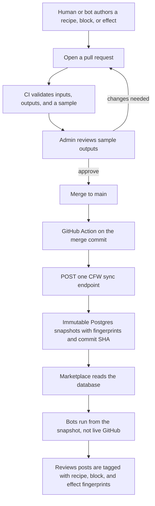

# CFW Studio: target design

**Proposed, not built.** This is the agreed target for how CFW Social will store, share, and run building blocks and recipes. It is not a description of the current application. See [DECISIONS.md](DECISIONS.md) for why each choice was made, and [MIGRATION.md](MIGRATION.md) for how to get here from today's system.

As of 19 November 2026 (America/Chicago), this public repository exists as a design-and-scaffold tree. The runtime pieces (CI, the CFW sync endpoint, Marketplace reads from snapshots, and Reviews tagging) still have to be built.

## The idea

Building blocks (`c-*`) are reusable Lego pieces: instructions plus supporting scripts, each with declared inputs and outputs. Multiple variations of a block may coexist.

Effects live in the top-level `effects/` folder. An effect is a block of `kind: effect` — the same contract as any other block — for a visual or audio treatment such as a transition, confetti, fireworks, a caption style, an overlay, a sound effect, or a music bed. Proposed effect ids use the `e-*` prefix. A recipe references an effect the same way it references any other block: by id and variation, in its `blocks` list.

Recipes are guiding documents that compose those blocks and effects. A recipe's inputs are the union of its blocks' required inputs, and the recipe declares the final output. Any agent can read a recipe and run it as-is, or compose a new one and submit it.

The source of truth is this public GitHub repository, not Postgres and not a deploy. People and bots contribute through pull requests. An admin approves by reviewing sample outputs and merging. On merge, one CFW endpoint snapshots the changed effects, blocks, and recipes into Postgres as immutable, fingerprinted copies with the commit SHA. The Marketplace reads those tables. Bots run from the snapshot so every server renders the same files. Posts that reach Reviews are tagged with the recipe, block, and effect fingerprints, which supports usage tracking and retirement. There is no heavy semver: only a light fingerprint and a variation id.

This is intended to replace today's master-key `publish.mjs` path, the VENDORED manifest map in code, the code-based Marketplace allowlist, and the separate `skills` table as the catalog bots see.

## Building blocks

A block lives in `blocks/c-<name>/` and contains:

- `block.yaml` — identity, kind, variation, and declared inputs and outputs
- `SKILL.md` — the instructions an agent follows
- `scripts/` — supporting scripts the instructions call

### Proposed `block.yaml` fields

| Field | Role |
| --- | --- |
| `id` | Stable slug, for example `c-transcribe`. Blocks in `blocks/` use `c-*`. |
| `kind` | `component` or `step` for folders in `blocks/`. Effects use `kind: effect` and live under `effects/`. |
| `variation` | Light variation id (for example `default` or `karaoke-glow`). Not semver. A new variation is a sibling, not a replacement, until the old one is retired. |
| `label`, `summary` | Human-readable name and one-line description. |
| `inputs[]` | `id`, `type` (`text`, `json`, `image`, `video`, `audio`), `required`, `cardinality` (`one` or `many`), and a short description. |
| `outputs[]` | Same shape as inputs: what this block produces. |
| `needs` | Optional tools, OS, or providers the block requires. |

The **fingerprint** is computed at sync time: a hash of the contract plus the instruction and script files. It is stored in CFW, not authored by hand.

## Effects

An effect lives in `effects/e-<name>/` and contains:

- `effect.yaml` — the manifest (same field shape as `block.yaml`, with `kind: effect`)
- `SKILL.md` — the instructions an agent follows to apply the effect
- `scripts/` — supporting scripts the instructions call
- a preview file (gif, video, still, or audio) so reviewers can judge the look or sound

Effects are not a separate product type at runtime. They are blocks that recipes reference. They get their own folder so the library of looks and sounds is easy to browse and contribute to. Start from `effects/_template/`.

## Recipes

A recipe lives in `recipes/p-<name>/` and contains:

- `recipe.yaml` — identity, the ordered list of blocks, the input union, and the final output
- `SKILL.md` — the guiding document: when to use it, how the blocks fit, and any coordination the agent needs

### Proposed `recipe.yaml` fields

| Field | Role |
| --- | --- |
| `id` / `label` | Stable slug such as `p-reels-clipper`, plus a marketplace name. |
| `blocks[]` | Ordered list of block or effect ids and variation ids. This is the Lego list. Effects are included here; there is no separate effects array. |
| `inputs` | Union of the required inputs of those blocks, plus any recipe-level optional settings. An agent can read this and know what to ask for. |
| `output` | The final deliverable: kind, aspect, cardinality (`one` or `many`), and a short description. |

## Proposed recipe: p-reels-clipper

A clipper recipe would take one long source video and produce a variable number of 15–60 second vertical shorts. That output shape is not expressible in today's fixed `finalOutputs` list, so the new contract needs a `many` cardinality. Do not copy AGPL third-party clipper code; write CFW blocks from the ideas.

| Block | Role | Status |
| --- | --- | --- |
| `c-ingest-video` | Accept a long source video | Partial — today's reel inputs assume a short talking-head bed |
| `c-transcribe` | Words and timestamps | Reusable from today's transcribe pattern |
| `c-score-moments` | Score hook, engagement, value, and shareability; 3–9 word hook titles | **New block needed** |
| `c-cut-on-sentences` | Cut 15–60 second clips on sentence boundaries | **New block needed** |
| `c-reframe-9x16` | Vertical around faces, or full frame on a blurred bed when a tight crop would clip slides or people | **New block needed** |
| `c-captions` | Karaoke-style captions | Partial — today's captions are not yet a reusable style-pack block |
| `c-shorts-qa` | Duration, canvas, cover, captions QA | Reusable pattern for one reel, not yet for N clips |
| Variable output | A list of shorts, not one deliverable | **New contract needed** |

Proposed recipe inputs, as the union of those blocks: required `source_video`; optional `max_clips`, `mode` (`highlights`, `recap`, or `trailer`), and `caption_style`. Proposed output: many vertical videos, 1080×1920, 15–60 seconds each.

## Repo layout

```text
cfw-studio/
  README.md
  CONTRIBUTING.md
  AGENTS.md
  LICENSE
  docs/
    DESIGN.md
    DECISIONS.md
    MIGRATION.md
  effects/
    README.md
    _template/
      effect.yaml
      SKILL.md
      scripts/
      PREVIEW.md
    e-*/                 # one folder per effect (kind: effect)
  blocks/
    README.md
    _template/
      block.yaml
      SKILL.md
      scripts/
    c-*/                 # one folder per building block
  recipes/
    README.md
    _template/
      recipe.yaml
      SKILL.md
    p-*/                 # one folder per recipe
  .github/workflows/     # proposed CI; not written yet
```

Proposed CI, once added, should validate input and output declarations and run or attach a sample (and, for effects, a preview). This repository does not yet include that workflow (no application code is being added with this design).

## Contribute, approve, and sync



- **Approval.** The merge is the approval. Admins review sample outputs attached to the PR, not a deploy and not a code allowlist.
- **Proposed sync endpoint.** `POST /api/v1/admin/studio/sync`, called only after a merge to `main`. The body includes the commit SHA, an optional PR number, and the changed effect, block, and recipe paths. CFW fetches that commit, hashes files, and upserts immutable snapshot rows. The same commit SHA is a no-op. Bots never run from live GitHub.
- **Auth (preferred).** GitHub Actions OIDC. The Action requests a token for the CFW audience. CFW verifies the issuer, the repository (`cfw-social/cfw-studio`), and that the ref is `main` after a merge. No long-lived token is stored in the repo.
- **Auth (fallback).** A signed GitHub webhook or GitHub App, with the shared secret held only in Actions and in CFW, never committed.
- **What bots do.** Learn from the repo, run or adapt published snapshots, and open PRs for new effects, blocks, or recipes. They do not upload snapshots directly into Postgres.

## Proposed snapshots and post tags

These tables are proposed, not built. Prefer adapting today's `recipe_library_*` tables plus a new tag table, rather than a second catalog.

| Proposed table | What it stores | Notes |
| --- | --- | --- |
| Studio snapshots (or reused `recipe_library_*`) | One immutable row per effect, block, or recipe fingerprint: slug, variation id, fingerprint, commit SHA, declared inputs and outputs, kind, file tree hashes, and status (`listed`, `unlisted`, or `retired`) | A merge inserts new fingerprints. Old rows are never rewritten. Retiring sets status; the bytes stay so old posts still resolve. |
| Marketplace flag | A listed (or approved) flag on the recipe snapshot, set when the PR is merged | Replaces the code-based Marketplace allowlist and the `skills` table as the catalog `list_recipes` and the Marketplace read. |
| Review post tags | For every post that reaches Reviews: post id, recipe fingerprint, ordered block and effect fingerprints, and commit SHA | Enables usage counts and retirement of unused recipes, blocks, or effects. Nothing tags posts this way today. |
| Sync audit | Commit SHA, PR number, synced-at, and the fingerprints written | Makes the webhook or Action idempotent and debuggable. |

## Open questions

- Where do today's existing effect implementations actually live, so they can be copied into `effects/`? There was no `cfw-effects` repository in the `cfw-social` org when this design was written, and this repo's original README contained only `# cfw-effects`. New effects belong in `effects/`.
- Reuse today's `recipe_library_*` tables, or add new `studio_*` tables?
- How should a variable list of outputs (N shorts) be declared in the recipe contract?
- Who may merge (org admins only, or a named reviewer team)?
- Ship v1 auth as GitHub OIDC, or start with a signed webhook?
- What happens to the archived public `cfw-skills` repo once `cfw-studio` is the source of truth?
- How are brand-private or unlisted recipes represented, if at all, in a public repo?
- Where do sample outputs live for review (PR attachments, a `samples/` folder, or CI artifacts)?
- Retirement policy: manual only, or automatic after a period with no tagged posts?
- This repository is already licensed GPL-3.0. Is that the intended license for contributed blocks and recipes?
- Bot contributor identity, rate limits, and how a bot proves a sample run.
- Fingerprint algorithm: reuse today's `HASH_FORMAT 1`, or a simpler file-tree hash? What does a variation id look like?
